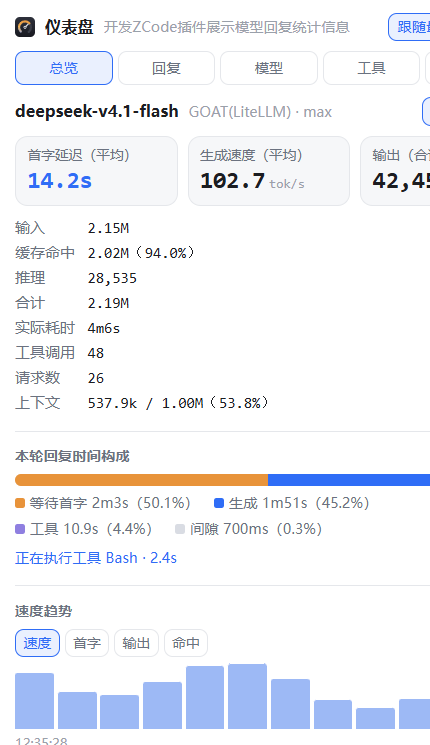
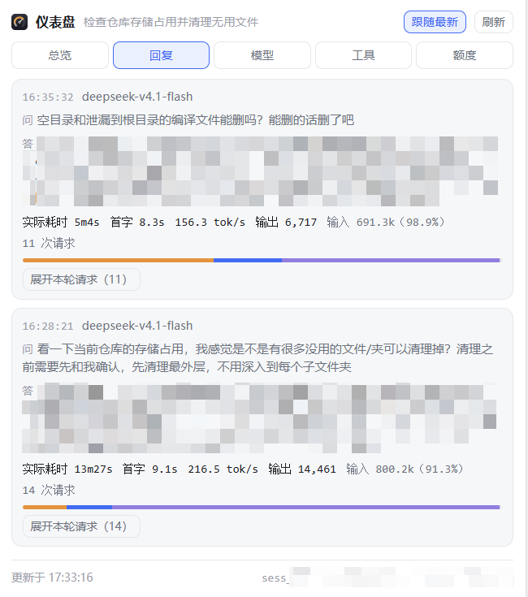
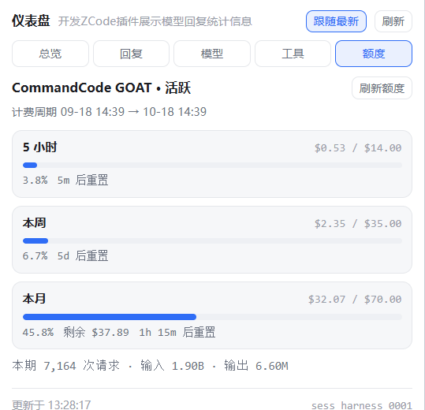

# Instrument · 仪表盘

A reply-metrics panel for [ZCode](https://github.com/zai-org/ZCode): every model reply's
first-token latency, generation speed, token usage, where the turn's time actually went,
context-window usage, health, and your CommandCode subscription quota — in the session sidebar.

ZCode 会话侧栏面板：每条回复的首字延迟、生成速度、token 用量、时间构成、上下文占用、健康度，
以及 CommandCode 订阅额度（5 小时 / 周 / 月）。



> 非官方插件，与 ZCode、CommandCode 官方无隶属关系。测试环境：ZCode 3.15.3.8237（Windows）。

---

## 功能 · Features

| 标签 | 内容 | What it shows |
| --- | --- | --- |
| **总览** | 本轮 / 会话双视角（同一个开关联动大数字、明细和时间构成）：平均首字、平均生成速度、输出合计、输入/缓存/推理/合计、耗时、工具调用、请求数、上下文占用；**时间构成**四段（等待首字 / 生成 / 工具 / 间隙）；速度趋势（速度/首字/输出/命中可切换） | Turn/session scope toggle; average first-token latency, speed, token totals, context usage; time composition in four slices; speed trend |
| **回复** | 每条回复一张卡：提问与回复摘要、实际耗时、首字、速度、输出、输入命中率、请求数，4px 时间构成细条；展开看逐请求明细（首字/生成/工具数/尝试次数） | One card per reply with a turn-scoped summary; expand for per-request detail |
| **模型** | 按模型/网关的请求数、平均首字、平均速度、命中率、失败数；本会话 / 本工作区两个范围 | Per-model aggregates, session or workspace scope |
| **工具** | 工具耗时排行（次数/最慢一次/报错）、健康度（成功率、失败、取消、重试、最近 20 轮色块）、失败与重试明细 | Tool time ranking, health trend, failures |
| **额度** | CommandCode 订阅：5 小时 / 本周 / 本月已用与上限、重置倒计时、本月剩余、本期请求与 token 总量 | CommandCode quota with reset countdowns |

| 回复列表 | 额度 |
| --- | --- |
|  |  |

Also included:

- `/metrics` slash command and a model-facing `metrics` tool (works without opening the panel)
- a `quota` tool so the agent can answer "how much quota is left?"
- a standalone CLI: `node scripts/metrics.mjs --cwd "$PWD" --format markdown --detail`
- an in-panel card template (`assets/metrics-card.html`) for inline rendering

## 安装 · Install

**方式一：作为市场添加（推荐）**

ZCode → **插件市场 / Plugin Marketplace → 添加 → 添加插件市场 / Add Plugin Marketplace** →
粘贴本仓库地址 `https://github.com/Againstthewindtofly/zcode-instrument`（或本地目录）→ 在
**个人 / Personal** 里找到 **仪表盘 (Instrument)** → 安装 → 新建会话。

**方式二：本地开发**

把这个目录作为一个市场根目录（其中包含 `marketplace.json`），在 ZCode 里添加该目录。

## 数据与隐私 · Data & privacy

- 所有指标来自 ZCode 自己的本地用量库 `~/.zcode/cli/db/db.sqlite`
  （`model_usage`、`tool_usage`、`part`、`session`），**只读**打开。
- Provider 显示名来自 `~/.zcode/v2/provider_config.json` 和安装目录的
  `resources/config/provider/zcode-builtin.json`；解析不到就显示内部 id。
- 额度查询使用 CommandCode 的 API key（自动从 ZCode 的 provider 配置读取，或用插件配置
  `commandCodeKey` 指定）；key 不写日志、不出现在面板和工具输出里，只发给 `api.commandcode.ai`。
- 面板本体运行在沙箱 iframe 中，资源声明了 `connectDomains: []`，自身没有网络权限；所有本地/网络读取
  都由插件的 MCP server 完成。
- 无遥测。

## 参考的开源项目 · Credits

这个插件是站在别人肩膀上的，特别感谢：

| 项目 | 用途 |
| --- | --- |
| [zai-org/ZCode](https://github.com/zai-org/ZCode) | 宿主本体。插件清单、市场目录、侧栏 UI surface（`ui.surfaces` / `ui://`）、provider 配置与本地 SQLite schema 都对照它的源码确认 |
| [modelcontextprotocol/ext-apps](https://github.com/modelcontextprotocol/ext-apps) | **MCP Apps** 协议。面板的 `ui/initialize` → `ui/notifications/initialized` → `tools/call` 握手、`ui/notifications/size-changed`、`host-context-changed` 均按该协议手写实现（无运行时依赖） |
| [Kevinzzz6/zcode-context](https://github.com/Kevinzzz6/zcode-context) (MIT) | 关键参考：它证明了 ZCode 插件可以用 `ui.surfaces` + `ui://` 资源 + `visibility: ["app"]` 的工具做出侧栏面板。本插件的面板契约通过它和宿主源码交叉验证 |
| [peach0x33a/cmdcode2api](https://github.com/synthetic-coworkers/cmdcode2api) · [safzanpirani/pi-commandcode-provider](https://github.com/safzanpirani/pi-commandcode-provider) | CommandCode 额度端点的来源（`/alpha/billing/credits`、`/alpha/billing/subscriptions`、`/alpha/usage/summary`），与 `cmd` CLI 的 `/usage` 同一套内部接口 |
| [steipete/CodexBar](https://github.com/steipete/CodexBar) | 额度字段语义的交叉验证（月度额度是"剩余"、5h/周窗口是滚动窗口） |

运行时**没有任何第三方依赖**：MCP server 与脚本只用 Node 内置模块（`node:sqlite` 需要 Node ≥ 22.5），
面板是单文件 HTML/CSS/JS。

## 已知限制 · Limitations

- 消息悬浮工具条右侧没有插件扩展点；面板是会话侧栏（这是宿主提供的唯一 UI 入口）。
- 正在生成的请求还没有落库，所以"进行中"的阶段是从上一个事件结束推断的，每 3 秒刷新会跳一下。
- 约三成请求没有首字时间记录（整段一次性返回），"等待首字"因此是下限；面板会把条数标在悬停提示里。
- 额度端点是 **alpha 内部接口**，官方未承诺稳定性；失败时面板会明确报错，不会显示成 0。
- 侧栏标签图标由 `ui.surfaces.icon` 的 Lucide 名字决定（当前 `gauge`），不能用自定义图片；
  插件列表图标需要市场条目的 `icon` 是一个 HTTPS URL。

## 开发 · Development

```bash
node test/mcp-smoke.mjs          # 41 项：握手 / 资源 / 工具可见性 / 会话绑定 / 载荷 / provider 名
python -m http.server 8800       # 然后打开 test/panel-harness.html 模拟宿主调试面板
```

目录结构见 [`instrument/README.md`](instrument/README.md)。

## License

MIT © 2026 Yedou — 见 [LICENSE](LICENSE)。
